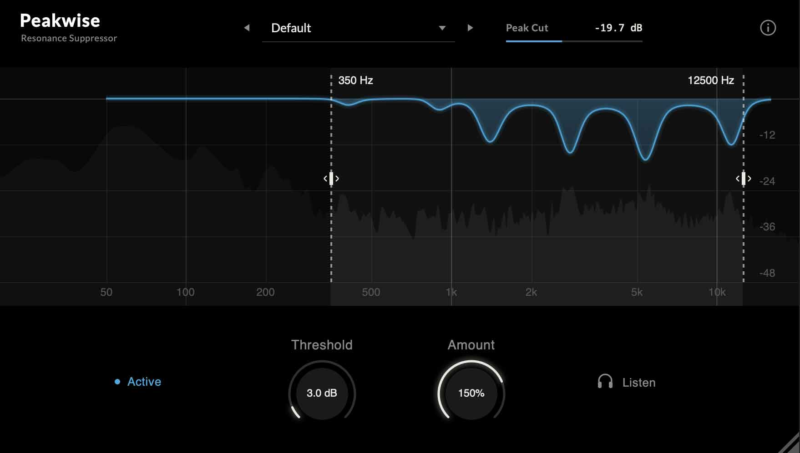

# Curated Signals

**Thoughtfully crafted. Freely shared.**

A curated collection of free, open-source audio plugins built with **JUCE & HISE**.

Curated Signals is an independent collection of audio tools designed with a simple philosophy: **great sound, purposeful functionality, and thoughtful design.**

From essential mixing utilities to creative sound-shaping processors, each plugin is crafted to deliver a focused, intuitive experience without unnecessary complexity.

Made for musicians, producers, and audio engineers who value tools that simply work.

---

## The Collection

### PeakWise
**Dynamic Resonance Suppressor**

Control unwanted resonances, tame harsh frequencies, and bring clarity and balance to your sound.

  

*Precision where it matters. Transparency where it counts.*

---

## Our Philosophy

**Purposeful by design.** Every plugin focuses on solving real audio challenges with practical, accessible controls.

**Sound comes first.** DSP quality, musical responsiveness, and reliable performance take priority over unnecessary features.

**Crafted with care.** Clean interfaces, thoughtful workflows, and attention to detail are part of every project.

**Free to explore.** Source code is available for learning, experimentation, modification, and collaboration.

---

## Built With

- **[JUCE](https://juce.com/)** — Cross-platform framework for audio software development.
- **[HISE](https://hise.dev/)** — Open-source framework for building audio plugins and instruments.

## Open Source & Licensing

Curated Signals is built around the spirit of open-source development.

Projects are distributed under their respective **GNU licenses**. Please refer to each project's license information for the applicable terms, permissions, and conditions.

Contributions, suggestions, and improvements are welcome.

---

  <strong>Curated Signals</strong>

  <em>Made for sound. Shared with everyone.</em>

